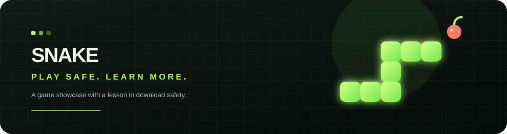

  

  <h1>Snake: Play Safe, Learn More</h1>
  
<strong>A Snake-themed showcase and a lesson in recognizing risky downloads.</strong>

  
Explore the page · Understand the warning signs · Protect your device

---

> [!CAUTION]
> **The desktop program represented by the source in this repository is not a safe game download. Do not run it.** Its launcher starts remote-access software that can execute commands, collect system information, transfer files, capture screenshots, and create a Windows Startup entry. No game download is offered here.

## What visitors will find

The website is a static Snake-themed showcase with a decorative game illustration and practical guidance for evaluating software downloads. The illustration is not a playable browser game, and this repository does not provide a safe desktop game to download.

The cybersecurity material focuses on a simple defensive lesson: a familiar name, icon, or game window does not guarantee that a program only does what its appearance suggests. The source files provide an example of why it is important to question software that performs actions unrelated to its advertised purpose.

## Recognizing the risk

The included desktop source combines a game window with a remote-access client and a companion listener. Together, these components can allow a remote operator to request system commands, inspect system details, transfer files, capture a screenshot, and arrange for the client to start again with Windows. Those actions can expose a device and personal data.

These capabilities are described to help readers recognize and understand risk—not as a recommendation to operate the software. The stated educational purpose does not make the program harmless.

## Safer software habits

- Check who published a program and whether the download comes from a source you independently trust.
- Be cautious when an app requests access or performs actions that do not make sense for its advertised purpose.
- Do not treat an attractive website, familiar branding, or a working game window as proof that a download is safe.
- Avoid running unknown programs on devices that contain personal, school, or work data.
- If reviewing suspicious software is necessary, ask a qualified security professional. Do not experiment on a personal device or a network you do not control.

## About the files

- [`index.html`](index.html) — the website showcase and visitor safety information.
- [`PayloadScripts/`](PayloadScripts/) — source files described in the [component safety notes](PayloadScripts/README.md). They are for static review only; do not run them.
- [`downloads/`](downloads/) — explains that downloads are paused; no executable is included.
- [`assets/snake-banner.svg`](assets/snake-banner.svg) — decorative artwork used at the top of this page.

No claim is made that the source or any previously distributed build has been independently audited or is safe. A download button being absent does not make copies hosted elsewhere safe or unavailable.
